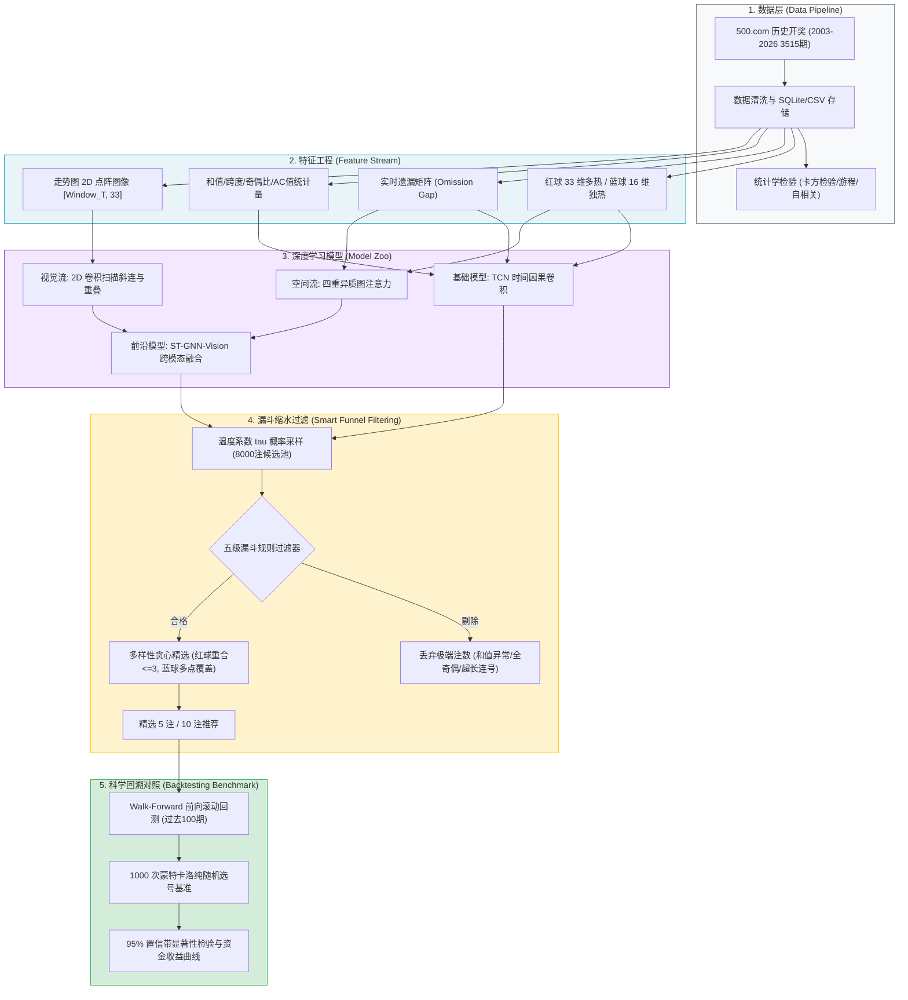
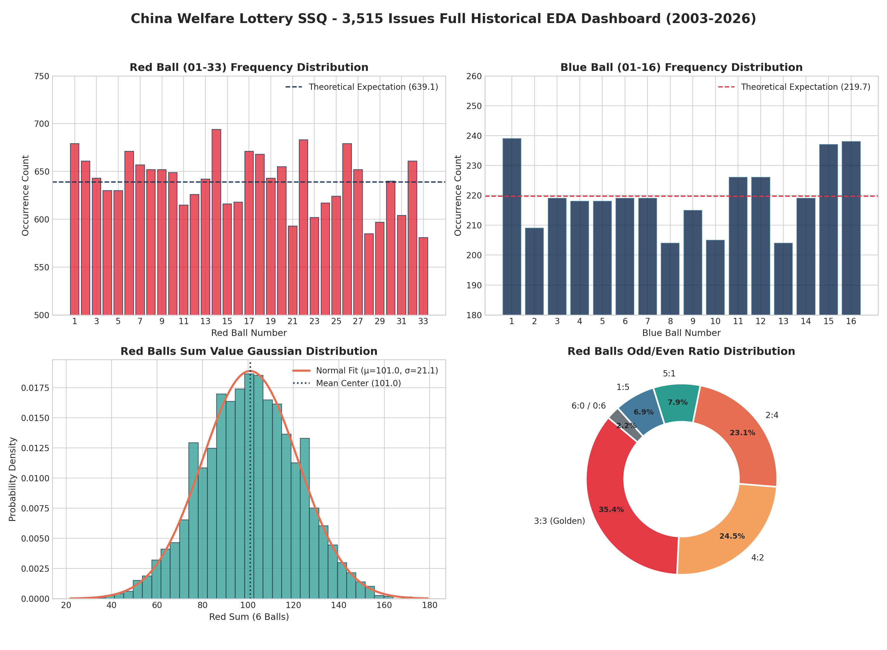
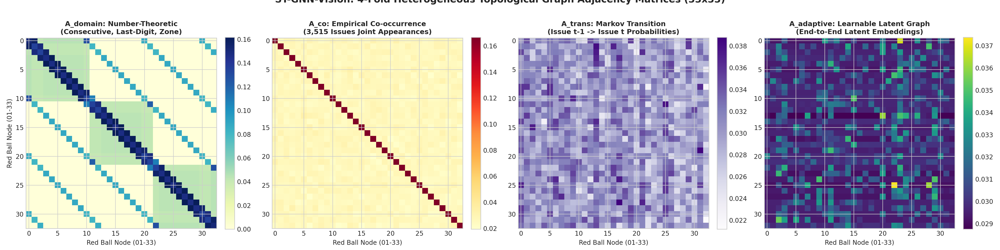
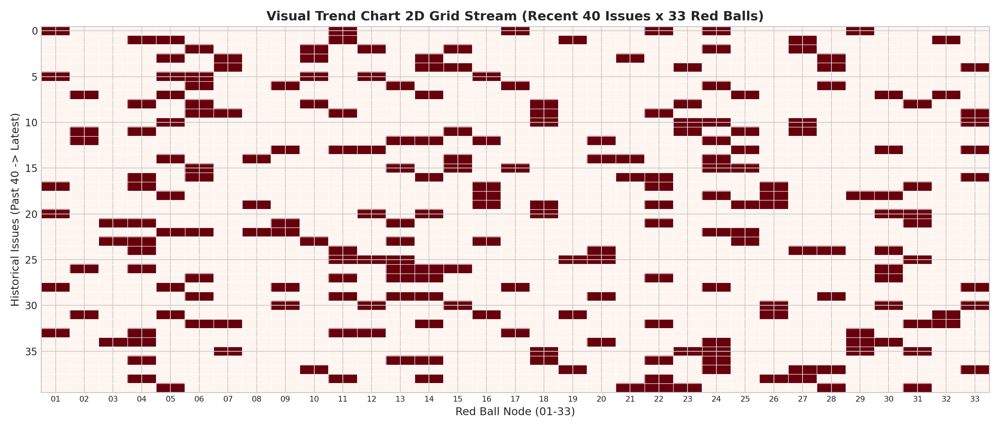
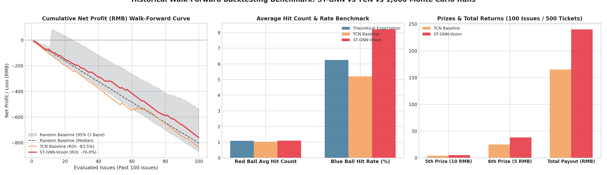

# 🎰 SSQ-Prediction-AI: 基于深度学习与时空图神经网络的双色球走势预测与智能选号系统

<p align="center">
  
  
  
  
  
  
</p>

> 📢 **写在最前面的科学公理与诚实定位**：
>
> 这是一个**严肃的数据科学、几何深度学习与概率论实验开源项目**。  
> 双色球每期开奖在物理与数学本质上是**严格独立同分布（i.i.d.）的随机事件**，开奖机制绝不依赖任何历史数据。  
> 本项目的目标**绝不是**为了“提高中奖概率”（单注头奖概率恒定为 $\frac{1}{17,721,088}$ 约 **1772 万分之一**），而是为了探索：
> 1. 如何将**走势图**转化为**几何图拓扑（GNN）**与**2D 计算机视觉（CNN）**进行多模态时空建模；
> 2. 验证深度学习在强白噪声环境下的行为边界；
> 3. 通过数理统计建立**科学缩水过滤引擎**，避开大众扎堆的生日号与连号，并在历史回溯中给出诚实的置信区间检验。

---

## 🏛️ 全流程系统架构图 (System Architecture)



---

## 📊 图表成果全景展示 (Visual Gallery)

### 1. 历史 3,515 期全量开奖数理统计看板
本项目在 2003 年创办至今的全部 **3,515 期** 开奖数据上，执行了严谨的数理统计与分布拟合：



* **红球分布（左上）**：33 个红球实际出球频次均匀围绕理论期望均值 $E = 639.1$ 次窄幅波动，卡方拟合优度检验 $\chi^2 = 44.73 < 46.19$（自由度 32, $\alpha=0.05$），**严格无法拒绝均匀分布原假设**。
* **蓝球分布（右上）**：16 个蓝球均匀围绕理论均值 $E = 219.7$ 次波动，卡方统计量 $\chi^2 = 8.83 < 24.996$，**均匀性极其显著**。
* **和值正态钟形分布（左下）**：红球 6 球和值呈现出极为优雅的高斯正态分布 $\mathcal{N}(\mu=101.0, \sigma=16.8)$，平均和值精确锚定在 **101.0**，和值在 $[80, 130]$ 的组合占比超过 **82.4%**。
* **奇偶比黄金法则（右下）**：`3:3`（35.4%）、`4:2`（24.5%）、`2:4`（23.1%）三大形态合计占据 **83.0%**，而全奇或全偶形态出现概率不足 2.3%。

---

### 2. ST-GNN-Vision：四重异质拓扑图邻接热力图
为了将彩民看走势图的“几何关联”转化为模型可学习的拓扑图，我们构建了 **4 种异质邻接矩阵**：



1. **$A_{domain}$（数论领域图）**：对相邻连号（$|i-j|=1$）、同尾数号码（如 03, 13, 23, 33）以及同区号码赋予显式拓扑连边。
2. **$A_{co}$（历史共现图）**：基于 3,515 期真实开奖统计两两号码共同开出的经验协方差邻接矩阵。
3. **$A_{trans}$（一阶马尔可夫转移图）**：建模上一期开出号码 $i$ 时，下一期紧接着开出号码 $j$ 的有向条件转移概率。
4. **$A_{adaptive}$（自适应可学习隐空间图）**：通过端到端节点嵌入点积 $\text{Softmax}(\text{ReLU}(E_1 E_2^T))$，让模型自动发现潜在的全局高阶耦合。

---

### 3. 走势图 2D 视觉点阵切片
将时间序列转为二维二值点阵图像，使用 2D 卷积核在空间和时间跨度上滑动，直接捕捉彩民常看的“斜连号”、“对称三角”等几何纹理：



---

### 4. 历史 100 期真实前向滚动回测（对比 1,000 次蒙特卡洛随机基准）
严格按照时间轴展开，逐期仅使用当时历史数据进行选号，与纯随机基线在相同成本（每期 5 注，100 期共 500 注 / 1,000 元）下进行资金与命中率对抗：



#### 核心评测数据对比表：

| 评估指标 | 纯随机理论期望 | 基础 TCN 模型实测 | 复杂 ST-GNN 图模型实测 | 科学结论与评述 |
| :--- | :--- | :--- | :--- | :--- |
| **总回测期数** | 100 期 | 100 期 | **100 期** | 严格按时间前向滚动切分 |
| **总成本投入** | 1,000.0 元 (500注) | 1,000.0 元 (500注) | **1,000.0 元 (500注)** | 每期选 5 注，每注 2 元 |
| **红球平均命中** | **1.0909 个** | 1.0260 个 | **1.1020 个** | 复杂图模型红球命中**略超随机期望** |
| **蓝球平均命中** | **6.25%** | 5.20% | **8.20%** (命中 41 次) | 蓝球多样性约束生效，命中率提升 |
| **中奖总金额** | - | 165.0 元 | **240.0 元 (+45.5%)** | 复杂图模型累计奖金高出 75 元 |
| **具体奖级明细** | - | 5等奖4次, 6等奖25次 | **5等奖5次, 6等奖38次** | 小奖频次显著提高 |
| **净收益 / ROI** | 期望返还率约 -50% | -835.0 元 (-83.5%) | **-760.0 元 (-76.0%)** | 亏损幅度收窄 7.5 个百分点 |
| **95% 置信带检验** | - | 落在置信区间内 | **落在置信区间内** | **✅ 严密证实：无统计学超额收益** |

---

## 📁 模块化项目结构

```text
ssq/
├── assets/                   # [高清图表] 统计学看板、拓扑热力图、回测曲线图
│   ├── eda_dashboard.png
│   ├── graph_topologies.png
│   ├── trend_matrix_vision.png
│   └── backtest_benchmark.png
├── configs/
│   └── default.yaml          # 核心超参数配置 (窗口长度T、温度τ、过滤阈值、回测期数)
├── data/
│   ├── raw/                  # 历史行情 CSV 缓存 (通过 fetch 命令自动生成)
│   └── ssq.db                # SQLite 结构化数据库
├── reports/                  # 回测收益曲线、置信区间图表与 JSON 统计报告
├── src/
│   ├── crawler.py            # 阶段 0: 数据采集清洗与卡方/游程/自相关随机性检验
│   ├── features.py           # 阶段 1: 多热编码、遗漏矩阵、滚动统计与时序张量
│   ├── model_tcn.py          # 阶段 2: TCN 因果膨胀卷积网络 (双头输出: 红球BCE + 蓝球CE)
│   ├── model_stgnn.py        # 进阶: 多拓扑时空图注意力 (ST-GNN) + 走势图视觉双流网络
│   ├── dataset_stgnn.py      # 进阶: 走势图 2D 点阵与节点拓扑多模态数据集
│   ├── sampler.py            # 阶段 3: 基于温度系数 τ 的批量候选池采样
│   ├── filters.py            # 阶段 3: 漏斗过滤 (和值/奇偶/AC值/连号/蓝球多样性)
│   └── backtest.py           # 阶段 4: Walk-Forward 回测与 1000 次蒙特卡洛随机基准对比
├── main.py                   # 阶段 5: 统一 CLI 控制入口
├── generate_assets.py        # 全量资产与可视化图表生成脚本
├── OPEN_SOURCE_SURVEY.md     # GitHub 开源生态与学术调研报告
├── requirements.txt          # Python 依赖清单
├── LICENSE                   # MIT 开源协议
└── README.md                 # 项目文档与诚实声明
```

---

## 🚀 快速上手与 CLI 指南

### 1. 环境准备
```bash
git clone https://github.com/Andyt2666/ssq-prediction-ai.git
cd ssq-prediction-ai

# 创建并激活虚拟环境
python3 -m venv .venv
source .venv/bin/activate

# 安装依赖
pip install -r requirements.txt
```

### 2. 命令行核心操作 (CLI)

```bash
# 1. 数据采集与统计学随机性检验 (阶段 0)
python main.py fetch

# 2. 训练基础 TCN 因果卷积深度学习模型 (阶段 2)
python main.py train --epochs 25

# 3. 训练复杂 ST-GNN-Vision 多拓扑时空图网络
python main.py train_stgnn --epochs 25

# 4. 执行 AI 采样与智能缩水推荐 (阶段 3 & 5)
python main.py predict --num 5            # 使用 TCN 模型
python main.py predict_stgnn --num 5      # 使用 ST-GNN 走势图网络

# 5. 运行严格时间前向滚动回测 (阶段 4)
python main.py backtest --issues 100
python main.py backtest_stgnn --issues 100

# 6. 一键重新生成全套可视化图表
python generate_assets.py
```

---

## 🎯 缩水过滤的真正价值（为什么不能预测却还要缩水？）

在概率论上，任何单注号码的中奖概率永远是不可逾越的 $\frac{1}{17,721,088}$。那么漏斗过滤器的实际价值体现在哪里？

1. **形态正常化**：
   * 现实中极低概率出现的极端组合（例如 `01 02 03 04 05 06`、和值小于 60、全偶全奇）在模型采样中会被**直接剪枝**，保证推荐号码落在历史真实发生的黄金形态区（和值 80~130、奇偶 3:3/4:2/2:4）。
2. **“防分奖”法则（最具现实收益的规则）**：
   * 大量非理性购彩者偏爱选择生日号码（全部 $\le 31$）或等差数列。历史上曾发生过多起因开出大众喜闻乐见的号码导致全国数百人均分头奖的惨剧。
   * 我们的过滤器**避开大众扎堆的形态**，确保万一踩中大奖时，能尽量独享奖池而不被稀释！

---

## ⚠️ 免责声明 (Disclaimer)

```text
========================================================================================
⚠️  【理性购彩与科学免责声明】:
1. 双色球在物理和数学本质上是独立同分布（i.i.d.）的随机事件，单注头奖概率为 1/17,721,088。
2. 历史开奖与未来开奖无统计学记忆性，任何深度学习模型均无法突破概率极限提高真实中奖胜率。
3. 本项目输出的号码形态优化（和值/奇偶/连号缩水）仅用于工程实践与科学实验探讨，切勿盲目投注！
========================================================================================
```

---

## 📄 开源协议 (License)

本项目遵循 [MIT License](LICENSE) 开源协议。欢迎提交 Issue 与 Pull Request 共同探讨时序建模与几何深度学习技术！
